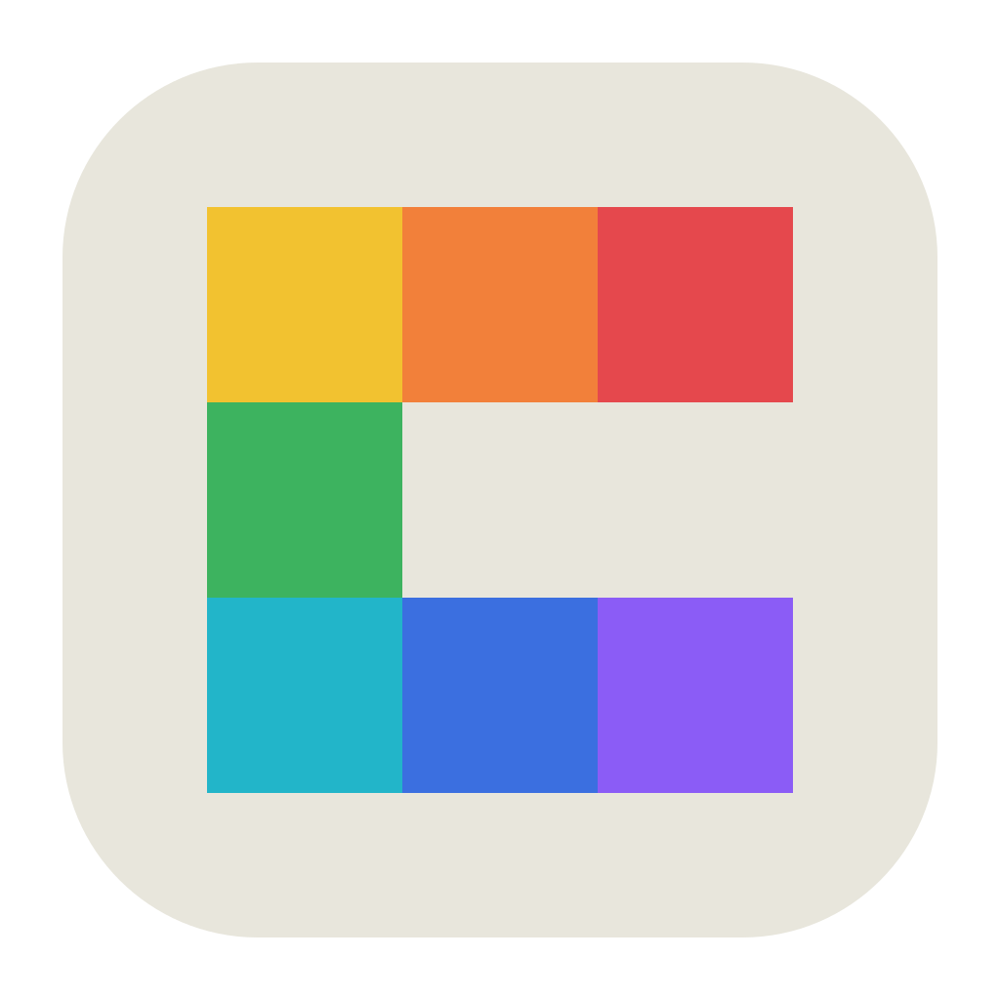
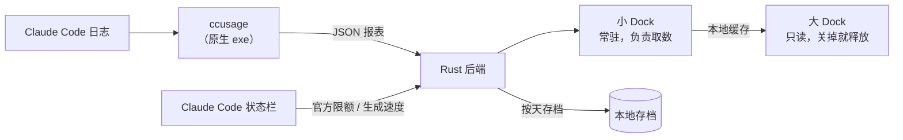

<div align="center">



# ccusage-ui

> 桌面角落里的 Claude Code 用量仪表
>
> 今天花了多少、5 小时窗口还剩多久、官方限额用到哪了，瞄一眼右下角就知道

[](https://github.com/mamawai/ccusage-ui/stargazers)
[](LICENSE)
[](#下载安装)
[](https://linux.do)

[](https://tauri.app/)
[](https://www.rust-lang.org/)
[](https://react.dev/)
[](https://www.typescriptlang.org/)
[](https://vite.dev/)

**[功能](#功能)** · **[下载安装](#下载安装)** · **[常见问题](#常见问题)** · **[本地开发](#本地开发)**

</div>

---

ccusage-ui 是 [ccusage](https://github.com/ccusage/ccusage) 的 Windows 桌面版。右下角常驻一张小卡片（小 Dock），显示今天的花费和官方限额，鼠标移上去展开明细；需要细看时打开主窗口（大 Dock），看趋势、会话和每个 5 小时窗口。所有数字都来自 ccusage，读的是你本机 Claude Code 的日志，数据不出本机。

## 为什么做 ccusage-ui

- **花费是看不见的**：ccusage 很好用，但每次都要开终端敲命令。ccusage-ui 把它变成一直摆在桌面上的小卡片，Claude Code 一写日志就跟着刷新。
- **订阅用户最关心限额**：官方的 5h / 7 天限额直接从 Claude Code 的状态栏读出来，还能估出这一轮 7 天额度大约值多少美元。
- **日志会被删，账不能丢**：Claude Code 默认只留 30 天日志。ccusage-ui 每天存一份档，还能从 CC Switch 补回以前的记录。

## 功能

### 小 Dock：常驻桌面的小卡片

- **今日花费**：大字显示，数字变化时滚动过去；接入官方限额后，旁边是 5h 限额的百分比、剩余时间和生成速度（tok/s）。
- **悬停展开明细**：本周花费、今日 Token、5h / 7 天限额（7 天的附带额度估算）、生成速度、5h 窗口剩余时间和窗口内已用、今天每小时的花费柱状图。
- **放哪都行**：可以拖到屏幕任意位置，靠近屏幕顶部时明细自动改成往下展开；鼠标不在卡片上时，点击会穿透到后面的窗口。
- **一点小乐趣**：展开时卡片下面随机一句换算，比如"今天的花费够买几杯咖啡"，174 样东西，每样的价格都在代码注释里写了出处，点一下换一句。今天的花费跨过 $5、$10、$20… 这些关口时，卡片外冒个气泡。

### 大 Dock：详细的用量分析

- **概览**：本期费用、今日费用、Token 总量、缓存读取占比，加上用量趋势、模型占比、项目排行和当前 5h 窗口。
- **会话**：全部会话按费用或时间排序、可搜索；点开看每次调用的 Token 和费用。
- **5h 窗口**：最近 3 天的时间线（每天 24 根小时柱 + 窗口底色带）、窗口内累计 Token 曲线、Token 构成、全部窗口列表。
- **7 天窗口**：官方 7 天限额的每一轮花了多少、用满一轮大约值多少、一个月大约多少。
- **时间范围**：今天 / 7 天 / 30 天 / 本月 / 全部。
- **统计范围**：只看 Claude Code（功能最全），或者看 ccusage 能读到的全部 Agent。

### 官方限额与订阅额度估算

- **读官方 5h / 7 天限额**：Claude Code 只在交给状态栏的数据里带限额。ccusage-ui 套在你原来的状态栏命令外面读出这部分数据，再原样交给原来的状态栏（比如 claude-hud），你看到的状态栏不变。第一次使用时会先问你，不同意就不接。
- **估 7 天额度值多少美元**：这一轮订阅已花费 ÷ 已用百分比，按 API 价格估算；用量不到 5% 时误差太大，不估。
- **自动剔除非订阅会话**：用 API key 或中转的会话（有回复却没带限额）会被认出来，估算时剔除。

### 数据不丢

- **按天存档**：每天的用量存一份，Claude Code 删掉旧日志后，图表里那些日子也还在。
- **从 CC Switch 导入历史**：只读 CC Switch 记录的用量，某一天它记得比这里多才用它的，不会重复算。

### 其他

- **ccusage 管理**：找出本机所有的 ccusage，检查更新，一键更新或回退。没装的话可以一键安装，不需要 Node.js。
- **两种价格**："联网核对"和在终端里直接跑 ccusage 结果一致；"内置价格"只用 ccusage 自带的价格表，不联网。
- **省资源**：取数只在小 Dock 里做，大 Dock 关到托盘时整个关掉；闲着时让 WebView2 把内存还给系统。
- 中文 / English 界面、浅色 / 深色主题、开机自启、托盘菜单、记住窗口位置、只开一个实例。

## 下载安装

> [!NOTE]
> 安装包还没发布，第一个版本发布后会放在 [Releases](https://github.com/mamawai/ccusage-ui/releases)。在那之前可以按[本地开发](#本地开发)自己构建。

> [!IMPORTANT]
> - 系统：Windows 10 / 11（x64）。macOS 和 Linux 暂不支持，有需求再做。
> - 要用过 Claude Code，本机有它的日志。
> - 官方 5h / 7 天限额只有 Claude Pro / Max 订阅才有。

不用提前装 ccusage 或 Node.js，第一次打开时会帮你装。

## 快速开始

1. **打开 ccusage-ui**：大 Dock 打开，屏幕右下角出现小 Dock。
2. **装 ccusage**（已经装过会自动找到）：列出本机能用的 npm / pnpm / bun / yarn，或者选"ccusage-ui 自带"，直接从 npm 下载 ccusage 的 Windows 原生程序，不需要 Node。
3. **接入官方限额**（可选）：第一次会问要不要接入 Claude Code 的状态栏。接入后在 Claude Code 里收到一条回复，限额就会显示出来。
4. **平时只看小 Dock**：鼠标移上去看明细；大 Dock 关掉会收到托盘，点托盘图标再打开。

## 工作原理



- 后端只允许调用固定的几种 ccusage 报表，前端不能传任意参数。
- Claude Code 的日志一有变化，就只取昨天和今天合并进账本；启动、每 30 分钟和点刷新时取一份完整的。
- 价格选"联网核对"时，完整取会联网取价格，再和 ccusage 内置的价格表对一遍：两边一样，平时就只用内置的；不一样就每次都联网。
- 小 Dock 取完数据存在本地，大 Dock 只读这份数据，所以大 Dock 可以随时关掉，不影响取数。

## 数据与隐私

- **数据都在本机**：ccusage 读 Claude Code 在本机的日志；存档、限额记录放在 `%APPDATA%\com.ccusageui.dock`。
- **会联网的只有这几处**：
  - 查 ccusage 新版本、下载自带版：`registry.npmjs.org`，下载后校验 sha512
  - 价格选"联网核对"时，由 ccusage 自己去取最新的价格表
  - 中文界面的大 Dock 状态栏每天取一条冷知识（`api.baiwumm.com`），一天只取一次
- **改 Claude Code 配置之前会先问你**：接入限额会改 `~/.claude/settings.json` 里的 `statusLine`，原来的设置另存在 `~/.claude/ccusage-ui-statusline.json`。在设置里关掉开关，或者卸载程序时，自动恢复原样。
- **读 CC Switch 只读用量**：只读它数据库里的用量记录，不碰供应商和密钥配置，也不往里写。

## 常见问题

<details>
<summary><b>数字和我在终端里跑 ccusage 不一样？</b></summary>

先看 设置 › 数据 › 价格。"联网核对"和终端里直接跑 ccusage 结果一致；"内置价格"只用 ccusage 自带的价格表，新模型的价格可能还没收录，算出来会少一些。

</details>

<details>
<summary><b>为什么不显示官方限额？</b></summary>

- 只有 Claude Pro / Max 订阅才有限额数据，用 API key 或中转没有。
- 要在设置里打开"官方 5h / 7 天限额"。
- 接入后要在 Claude Code 里收到一条回复，数据才会过来。

</details>

<details>
<summary><b>会不会弄乱我原来的状态栏？</b></summary>

不会。ccusage-ui 只是套在你原来的状态栏命令外面，读到限额后把数据原样交给它，你看到的状态栏和原来一样。在设置里关掉开关，或者卸载程序时，会恢复原来的配置。

</details>

<details>
<summary><b>7 天额度估算准吗？</b></summary>

这是估算：用这一轮订阅已经花的钱（按 API 价格算）除以已用的百分比。用量越多越准，不到 5% 时不估。API key 和中转的会话会被剔除，但**不要在同一个会话里混用订阅和中转**（比如第一句用订阅、后面切到中转），这种会话没法拆开算，估算会不准。

</details>

<details>
<summary><b>支持 macOS / Linux 吗？</b></summary>

第一个版本只做 Windows，有需求再做。

</details>

## 本地开发

需要：

- [Node.js](https://nodejs.org/) 20.19+ 或 22.12+
- [Rust](https://www.rust-lang.org/tools/install) 1.88+
- Visual Studio 生成工具（勾选"使用 C++ 的桌面开发"）
- WebView2 Runtime（Windows 11 自带）

```bash
git clone https://github.com/mamawai/ccusage-ui.git
cd ccusage-ui
npm install
npm run tauri dev      # 开发
npm run tauri build    # 打包，安装包在 src-tauri/target/release/bundle/nsis/
```

目录：

```text
src/               前端（React）
├─ dock/           小 Dock：常驻卡片，也负责取数
├─ pages/          大 Dock：概览、会话、5h 窗口、设置
├─ ccusage/        账本、限额、存档、价格核对
└─ i18n/           中文 / English
src-tauri/src/     后端（Rust）：调用 ccusage、窗口和托盘、状态栏转发、存档、CC Switch 导入
```

## 技术栈

- **桌面**：Tauri 2 · Rust（2024 edition）· WebView2
- **前端**：React 19 · TypeScript 6 · Vite 8 · Recharts 3
- **数据**：[ccusage](https://github.com/ccusage/ccusage)

## 致谢

- [ccusage](https://github.com/ccusage/ccusage)：所有用量数据都来自它
- [claude-hud](https://github.com/jarrodwatts/claude-hud)：生成速度的算法参考
- [CC Switch](https://github.com/farion1231/cc-switch)：导入历史用量
- 字体：[Geist](https://vercel.com/font)、[Source Serif 4](https://github.com/adobe-fonts/source-serif)

## 社区与反馈

感谢 [**LinuxDo**](https://linux.do/) 的佬友们。

*真诚、友善、团结、专业，共建你我引以为荣之社区。*

欢迎通过 Issue 和 Pull Request 反馈数据对不上、界面体验和新功能想法。

[MIT License](LICENSE) · 非 Anthropic 官方项目
